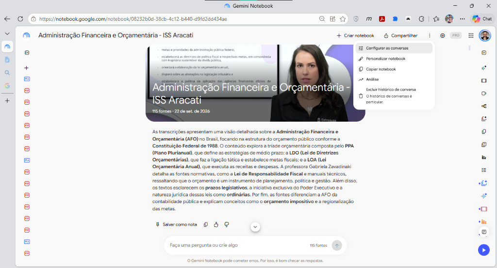
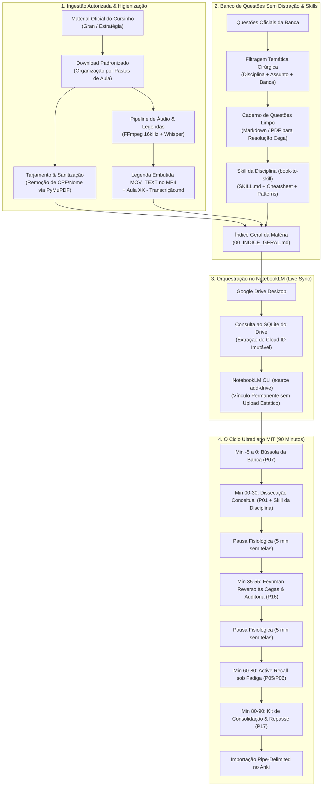

# 🏛️ Ecossistema N.A.G. (Núcleo de Aprendizagem Guiada) para Concursos Públicos
### Metodologia Aberta de Engenharia de Estudos, Ingestão de Materiais e IA Fundamentada (NotebookLM + Gemini Estudantes + Método MIT + Anki + Skills por Disciplina)

[](https://opensource.org/licenses/MIT)
[](https://www.python.org/)
[](https://notebooklm.google.com/)
[](https://apps.ankiweb.net/)
[](https://github.com/virgiliojr94/book-to-skill.git)

---

## 🎖️ Reconhecimento Metodológico: Padrão Book-to-Skill

> [!IMPORTANT]
> **CRÉDITO METODOLÓGICO ESPECIAL:**  
> A transição arquitetural deste ecossistema — que substituiu definitivamente os antigos frameworks genéricos estáticos (FFCC) por **Skills Atômicas e Modulares por Matéria** — é inspirada e adaptada diretamente do projeto:  
> 
> 👉 **[virgiliojr94/book-to-skill](https://github.com/virgiliojr94/book-to-skill.git)** (*Criado por Virgílio Jr.*)  
> 
> O padrão **`book-to-skill`** permite converter qualquer acervo didático (livros, apostilas de cursinhos ou leis) em uma **Skill Cognitiva Operacional** com *DNA da matéria*, *cheatsheet de prazos e fórmulas*, *patterns de bancas*, *glossário* e *capítulos modulares*.

---

## ⚖️ Aviso Legal, Ética, Não-Pirataria e Conformidade Jurídica (Disclaimer)

> [!CAUTION]
> **COMPLIANCE ESTATUTÁRIO, DIREITOS AUTORAIS E CÓPIA PRIVADA:**  
> Este projeto é **terminantemente contra a pirataria** e opera em estrita conformidade com o ordenamento jurídico brasileiro. O uso desta metodologia e de eventuais ferramentas associadas fundamenta-se nas seguintes premissas legais:

### 1. Invocação do Artigo 184 do Código Penal Brasileiro e Lei nº 9.610/1998 (LDA)
* **§ 4º do Artigo 184 do Código Penal c/c Artigo 46, II da Lei nº 9.610/1998:** É expressamente assegurada a legalidade da **cópia de obra intelectual para uso estritamente privado do copista**, desde que realizada **sem intuito de lucro (direto ou indireto)** e com a finalidade exclusiva de estudo individual e fixação pedagógica.
* **Finalidade Exclusiva de Processamento por IA:** Todo o ecossistema destina-se ao estudante que adquiriu de forma legítima e regular seus cursos preparatórios, baixando materiais estritamente para consumo offline pessoal, arquivamento e indexação de aprendizado guiado (*Source-Grounded Memory*) em modelos de inteligência artificial locais ou no Google NotebookLM.

### 2. Ausência de Intuito de Lucro e Proibição Rigorosa de Redistribuição
* **Vedação ao § 3º do Artigo 184 do Código Penal:** É terminantemente proibido comercializar, revender, alugar, compartilhar em grupos de rateio ou disponibilizar publicamente qualquer material didático de terceiros.
* A disponibilização a terceiros descaracteriza a cópia privada e configura ilícito civil e penal de pirataria sob **responsabilidade civil e criminal exclusiva e pessoal do usuário final**.

### 3. Responsabilidade do Usuário, Relação com as Plataformas e Extensões Futuras
* **Acesso Estritamente Legítimo:** O ecossistema exige que o usuário possua credenciais de acesso válidas, ativas e regulares nas plataformas de ensino contratadas.
* **Ferramentas de Apoio Local:** Versões modificadas de extensões ou scripts de automação que venham a ser disponibilizados futuramente pelo autor têm por finalidade exclusiva organizar em pastas locais **apenas aquilo que as próprias plataformas de cursinhos já permitem ao aluno baixar**, otimizando a taxonomia para o processamento de IA. Nenhuma extensão desse tipo está publicada neste repositório até que atinja maturação técnica completa.
* **Isenção de Responsabilidade do Desenvolvedor:** O desenvolvedor deste repositório disponibiliza exclusivamente metodologias abertas, instruções pedagógicas (prompts) e templates de estudo, isentando-se integralmente de qualquer utilização indevida, ilícita ou em desacordo com as diretrizes das plataformas de ensino praticada por quem as executa.

---

## ⚡ Quick Start (Comece em 3 Minutos)

Para começar a usar a metodologia imediatamente no seu material de estudo:

1. **Abra o NotebookLM:** Acesse [notebooklm.google.com](https://notebooklm.google.com) e crie um caderno para a sua disciplina (ex: `Direito Tributário`).
2. **Carregue os Prompts e a Skill da Matéria como FONTES:**
   * Baixe os arquivos deste repositório e suba nas **Fontes (Sources)** do caderno:
     * `system/SYSTEM_PROMPT.md`
     * `system/000_MASTER_INDEX.md`
     * Os prompts que você vai usar (ex: `prompts/PROMPT_P01_DetalharAula.md`, `PROMPT_P16_FeynmanReverso.md`, `PROMPT_P17_KitConsolidacao.md`)
     * A Skill da disciplina no padrão [`book-to-skill`](skills/) (ex: sua skill da matéria com `SKILL.md` ou cheatsheet).
3. **Suba os Materiais da sua Aula:** Adicione os PDFs da sua aula (teoria, slides, questões ou transcrições de videoaulas).
4. **Configure a Instrução da Conversa (Personalizar):**
   * No canto superior direito, clique nos três pontinhos e selecione **"Configurar as conversas"**:
   
   

   * Na tela que abrir, escolha a opção **"Personalizado"** e cole a instrução curta de [`system/PERSONA_NOTEBOOKLM.txt`](system/PERSONA_NOTEBOOKLM.txt).
5. **Execute seu Primeiro Ciclo no Chat:**
   ```text
   Use P01 com a Skill de Direito Tributário para a Aula 01.
   ```
Pronto! Você receberá uma dissecação estruturada em tabelas Markdown nativas (GFM), com filtro Pareto 80/20, matriz de confusão e ancoragem cirúrgica na lei seca.

---

## 🎨 Leia, Adapte e Personalize: Isto é um Ponto de Partida!

> [!TIP]
> **Este repositório é uma base modular, não uma camisa de força.**
> 
> A engenharia documentada aqui **não reflete 100% dos gostos e rotinas estritamente pessoais do autor**. O objetivo foi intencionalmente **generalizar a metodologia**, removendo particularidades e preferências idiossincráticas, para entregar um ecossistema flexível e verdadeiramente útil para qualquer estudante.
> 
> **O que você DEVE fazer:**
> 1. **Leia os arquivos e prompts:** Entenda a mecânica de cada `PXX`, do `SYSTEM_PROMPT.md` e do padrão `book-to-skill`.
> 2. **Ajuste ao seu estilo:** Se você prefere respostas mais concisas, altere os parâmetros. Se estuda para outra banca (como Cebraspe, FGV ou FCC), troque os exemplos. Se não usa o Anki, pode descartar a geração de flashcards.
> 3. **Faça o método ser seu:** A melhor metodologia de estudos é aquela que se adapta à sua carga horária, ao seu concurso-alvo e à forma como o seu cérebro aprende melhor!

---

## 🤖 Preciso saber programar? Qual o papel do Antigravity, Claude ou ChatGPT?

**NÃO, você NÃO precisa saber programar nem rodar scripts para usar este método!**

Existe uma separação clara entre a **Metodologia Cognitiva** e os **Aceleradores Opcionais**:

| Nível | Como Funciona | Quem Pode Fazer |
| :--- | :--- | :--- |
| **1. Modo Manual (100% no Navegador)** | Você baixa os PDFs e videoaulas do seu curso manualmente pelo navegador, sobe no NotebookLM, cola a persona e estuda com os prompts. | **Qualquer concurseiro, sem nenhum conhecimento técnico.** |
| **2. Modo Assistido por IA (Antigravity / Claude / ChatGPT)** | Você pode usar um assistente de IA como o **Google Antigravity**, **Claude** ou **ChatGPT** para te ajudar nas tarefas operacionais: renomear arquivos em lote, extrair áudios com FFmpeg ou organizar anotações. | Concurseiros que queiram acelerar tarefas repetitivas usando IA no computador. |
| **3. Modo Automatizado (Scripts Pessoais)** | Scripts para catalogar matérias em lote ou transcrever com Whisper via API. | Opcional e avançado. Os sites mudam layouts frequentemente, então cada estudante pode criar suas próprias automações se desejar. |

---

## 📌 O Que é o Ecossistema N.A.G.?

O **Ecossistema N.A.G. (Núcleo de Aprendizagem Guiada)** é um framework metodológico e técnico desenvolvido para estudantes de **concursos públicos de alta performance** (Carreiras Fiscais, Controle, Jurídicas, Policiais, TI e Dados).

A metodologia combate os dois maiores gargalos da preparação moderna:
1. **Sobrecarga Operacional e Fragmentação:** O tempo perdido procurando, renomeando e organizando centenas de PDFs, videoaulas e questões.
2. **Passivismo e Ilusão de Competência com IA:** O risco de usar modelos genéricos de IA que sofrem do fenômeno científico **"Lost in the Middle"** (Liu et al., 2024), alucinando artigos de lei ou gerando resumos superficiais que dão uma falsa sensação de domínio.

O N.A.G. ancora todo o aprendizado em um **universo estritamente fechado de fontes reais (*source-grounded memory*)** no **Google NotebookLM**, acionado pelo **Ciclo Ultradiano de 90 Minutos do Método MIT** e finalizando com retenção biológica de longo prazo no **Anki**.

---

## 🗺️ O Fluxo Operacional Completo (Ponta a Ponta)



---

## 📚 Guias Operacionais Detalhados (`docs/`)

Para aprofundar em cada etapa técnica da engenharia de estudos, consulte os manuais específicos:

* 📄 **[Guia 01 — Preparação do Ambiente e Ingestão de Materiais](docs/01_preparacao_e_ingestao.md)**: Setup de pastas, Gran vs. Estratégia, extração de áudio mono 16kHz, transcrição com Whisper, embutimento de legendas `mov_text` em contêiner MP4 e tarjamento de dados pessoais.
* 🎯 **[Guia 02 — Banco de Questões por Tópico e Estudo Sem Distrações](docs/02_banco_questoes_sem_distracao.md)**: Como aproveitar as baterias de questões dos próprios PDFs das aulas, utilizar os recursos oficiais de impressão e bancos integrados (QC, Gran e Estratégia) e auditar erros com a técnica dos *5-Whys*.
* ☁️ **[Guia 03 — Orquestração Google Drive & NotebookLM CLI](docs/03_orquestracao_drive_notebooklm.md)**: Por que nunca fazer upload manual de arquivos no navegador, como extrair os Cloud IDs persistentes do Google Drive e manter um *Live Sync* permanente.
* 🚀 **[Guia 04 — O Protocolo Diário de 90 Minutos (Ciclo Ultradiano MIT)](docs/04_guia_operacional_mit_90min.md)**: O roteiro minucioso minuto a minuto da sessão de estudo, regras de pausas sem tela, auditoria rígida e consolidação biológica no sono NREM.
* 📸 **[Demonstração Real — Dissecação Técnica de Videoaula no NotebookLM](docs/05_exemplo_real_dissecacao_video.md)**: Captura de tela da interface do NotebookLM em ação dissecando uma aula de AFO (PPA, LDO e LOA), organização real das fontes no painel lateral e a resposta completa gerada pela IA.
* 📊 **[Guia 06 — Relatórios Interativos no Gemini Notebook (Interactive Reports)](docs/06_guia_relatorios_interativos_gemini_notebook.md)**: Passo a passo visual de como criar relatórios dinâmicos compostos com o `P19`, incorporando Infográficos de alta densidade, Mapas Mentais nativos e Quizzes interativos no corpo do documento.
* 🔬 **[Demonstração Real — Raio-X de Incidência e DNA da Banca via Acervo de Questões](docs/07_exemplo_real_raio_x_questoes.md)**: Caso prático real de AFO mostrando como um acervo robusto de questões permite ao NotebookLM calcular incidência estatística (59,4%), mapear a concorrência e dissecar as pegadinhas de FGV, Cebraspe e FCC.
* 🧬 **[Guia 08 — Fundamentação Científica (VARK & Neurociência) e a Nova Fronteira: Gemini Estudantes](docs/08_fundamentacao_cientifica_vark_e_gemini_estudantes.md)**: O respaldo em ciência cognitiva (Paivio, Sweller, Karpicke, Bjork), a matriz multimodal VARK e o passo a passo da integração com a nova aba *Estudantes* do Gemini (`gemini.google.com/students`) com Canvas e Deep Research.

---

## 🧠 O Ciclo Ultradiano de 90 Minutos (Método MIT)

Em vez de resumos passivos que geram esquecimento acelerado, a sessão é estruturada em blocos de alta fricção neural:

| Bloco | Tempo | Módulo N.A.G. | Ação Cognitiva e Comportamental |
| :--- | :--- | :--- | :--- |
| **Passo 4.0** | **-5 a 0 min** | **`P07` (Raio-X da Banca)** | Mapeia as tendências estatísticas GTF, os artigos mais cobrados e as armadilhas da banca antes de abrir a aula. |
| **Bloco 1** | **00–30 min** | **`P01` + `Skill da Disciplina`** | Identificação do Pareto 80/20, matriz de confusão e decomposição da Lei Seca em tabelas GFM nativas. **Sem cópia manual.** |
| *Pausa* | *5 min* | **Descompressão** | **Zero telas.** Água e caminhada curta para permitir alívio da memória de trabalho. |
| **Bloco 2** | **35–55 min** | **`P16` (Feynman Reverso)** | O NotebookLM faz a provocação socrática em caso limite. O estudante redige a explicação **sem consultar notas**. A IA executa a **Auditoria Corretiva de 5 Pontos**. |
| *Pausa* | *5 min* | **Descompressão** | **Zero telas.** |
| **Bloco 3** | **60–80 min** | **`P05` / `P06`** | **Active Recall sob fadiga:** Resolução cega de questões e dissecação minuciosa com diagnóstico de causa raiz do erro. |
| **Bloco 4** | **80–90 min** | **`P17` (Kit Consolidação)** | Geração automática da Folha Resumo (1 página), Tabela de Erros Potenciais e Top 5 cards de oclusão Cloze para o **Anki**. |

---

## 📑 A Biblioteca de Prompts de Elite (P01 a P20)

Cada arquivo em `prompts/` é um agente instrucional modular calibrado para o motor de raciocínio do NotebookLM:

| Código | Arquivo | Fase Pedagógica | Função Tática |
| :---: | :--- | :--- | :--- |
| **`P01`** | [`PROMPT_P01_DetalharAula.md`](prompts/PROMPT_P01_DetalharAula.md) | Compreensão | Dissecação profunda da aula com Pareto 80/20, analogia operacional e Lei Seca estruturada em tabelas GFM. |
| **`P02`** | [`PROMPT_P02_AnalisePreditiva.md`](prompts/PROMPT_P02_AnalisePreditiva.md) | Estratégia | Engenharia reversa de distratores, classificação dos vetores de distorção e índice de vulnerabilidade da banca. |
| **`P03`** | [`PROMPT_P03_GarimpoBizus.md`](prompts/PROMPT_P03_GarimpoBizus.md) | Memorização | Mineração de mnemônicos e bizus com pergunta-âncora de prova e gatilho de aplicação imediata. |
| **`P04`** | [`PROMPT_P04_TutorTecnico.md`](prompts/PROMPT_P04_TutorTecnico.md) | Tutoria | Decomposição em primeiros princípios, resolução de dúvidas profundas e contraste de correntes/jurisprudência. |
| **`P05`** | [`PROMPT_P05_SimuladorQuestoes.md`](prompts/PROMPT_P05_SimuladorQuestoes.md) | Teste Ativo | Geração de questões inéditas no estilo exato da banca com calibragem cirúrgica de distratores psicológicos. |
| **`P06`** | [`PROMPT_P06_ResolucaoCirurgica.md`](prompts/PROMPT_P06_ResolucaoCirurgica.md) | Auditoria | Resolução forense item a item com diagnóstico da causa raiz do erro e regra de ouro inviolável. |
| **`P07`** | [`PROMPT_P07_RaioX.md`](prompts/PROMPT_P07_RaioX.md) | Radar Prévio | Mapeamento macro do perfil da banca examinadora via Matriz Gravidade-Tendência-Frequência (GTF). |
| **`P08`** | [`PROMPT_P08_SlidesExam.md`](prompts/PROMPT_P08_SlidesExam.md) | Auditoria | Geração de roteiro de slides por núcleos conceituais para uso no Estúdio. |
| **`P09`** | [`PROMPT_P09_Flashcards.md`](prompts/PROMPT_P09_Flashcards.md) | Repetição | Flashcards conceituais atômicos (1 fato = 1 card) com suporte duplo (Pergunta Direta e Cloze `[...]` para Anki). |
| **`P10`** | [`PROMPT_P10_QuizBanca.md`](prompts/PROMPT_P10_QuizBanca.md) | Simulação | Quiz interativo em 3 níveis progressivos (Literalidade, Doutrina e Jurisprudência/Casos Práticos). |
| **`P11`** | [`PROMPT_P11_Markmap.md`](prompts/PROMPT_P11_Markmap.md) | Visualização | Renderização da hierarquia da matéria em mapas mentais com sintaxe rigorosa Markmap / Obsidian. |
| **`P12`** | [`PROMPT_P12_AulaGuiadaMapa.md`](prompts/PROMPT_P12_AulaGuiadaMapa.md) | Navegação | Roteiro estruturado de aula narrada em áudio fluido conduzido através dos nós de um mapa mental. |
| **`P13`** | [`PROMPT_P13_MotorCognitivo.md`](prompts/PROMPT_P13_MotorCognitivo.md) | Diagnóstico | Motor cognitivo N.A.G. para resposta BLUF, tolerância zero a ruído e crivos de autoavaliação silenciosa (evals). |
| **`P14`** | [`PROMPT_P14_NarrarLei.md`](prompts/PROMPT_P14_NarrarLei.md) | Áudio/Voz | Roteiro de áudio falado (TTS) para narração dinâmica de lei seca comentada. |
| **`P15`** | [`PROMPT_P15_QuizCompilado.md`](prompts/PROMPT_P15_QuizCompilado.md) | Simulado | Extração de questões diretamente a partir de exemplos orais e discussões de videoaulas e revisões. |
| **`P16`** | [`PROMPT_P16_FeynmanReverso.md`](prompts/PROMPT_P16_FeynmanReverso.md) | **[Método MIT]** | Arguição socrática rigorosa, teste de fronteira em casos limites e quebra da ilusão de competência. |
| **`P17`** | [`PROMPT_P17_KitConsolidacao.md`](prompts/PROMPT_P17_KitConsolidacao.md) | **[Método MIT]** | Kit triplo pós-sessão de 90 min: Folha Resumo One-Pager, Matriz de Erros e Top 5 Cards de Oclusão (Cloze). |
| **`P18`** | [`PROMPT_P18_SintesePreditiva.md`](prompts/PROMPT_P18_SintesePreditiva.md) | **[Método MIT]** | Matriz global acumuladora de armadilhas da matéria para revisão acelerada de véspera de prova. |
| **`P19`** | [`PROMPT_P19_RelatorioInterativo.md`](prompts/PROMPT_P19_RelatorioInterativo.md) | **[Interativo]** | Hub de Relatório Interativo Adaptativo integrando teoria, tabelas GFM, mapas mentais e quizzes embutidos. |
| **`P20`** | [`PROMPT_P20_CadernoTatico.md`](prompts/PROMPT_P20_CadernoTatico.md) | **[Dashboard]** | Dashboard Estratégico Executivo All-in-One por aula com KPIs, Heatmap e metadados empíricos. |

---

## 🏛️ Arquitetura de Skills por Disciplina (`book-to-skill`)

Os antigos frameworks teóricos genéricos estáticos (FFCC) foram **substituídos definitivamente** por **Skills Modulares por Disciplina**, permitindo máxima especialização em cada concurso:

* Consulte a documentação e os modelos na pasta [`skills/`](skills/).
* Utilize o [`TEMPLATE_SKILL_DISCIPLINA.md`](skills/TEMPLATE_SKILL_DISCIPLINA.md) para gerar a skill da matéria a partir de qualquer livro ou curso.

### Sintaxe de Combinação em Duas Camadas no Chat:
```text
Use P01 com a Skill de Direito Tributário para a Aula 03 - Imunidades Tributárias.
Use P16 com a Skill de Contabilidade para CPC 25 (Provisões e Passivos Contingentes).
Use P06 com a Skill de Tecnologia e Dados para a questão sobre Window Functions em SQL.
Use P05 com a Skill de Raciocínio Lógico e Estatística para 5 questões inéditas sobre Distribuição Binomial.
```

---

## ❓ FAQ — Perguntas Frequentes

### 1. Funciona para qualquer matéria (TI, Estatística, Exatas, Jurídicas)?
**Sim, perfeitamente.** O método não é restrito ao Direito. A arquitetura [book-to-skill](https://github.com/virgiliojr94/book-to-skill.git) permite acoplar o DNA de qualquer matéria (Exatas, TI, Contabilidade ou Legislação Específica) diretamente no caderno do NotebookLM.

### 2. Deu erro de limite de 10.000 caracteres nas Configurações da Conversa. O que fazer?
**Você não deve colar o `SYSTEM_PROMPT.md` inteiro nessa caixa.**
* Os arquivos completos (`SYSTEM_PROMPT.md`, `000_MASTER_INDEX.md` e os prompts `P01` a `P20`) são subidos como **Fontes (.md)** do caderno.
* Na caixa de configurações da conversa, cole apenas a instrução curta de [`system/PERSONA_NOTEBOOKLM.txt`](system/PERSONA_NOTEBOOKLM.txt) (tem menos de 500 caracteres). A IA lerá as regras completas diretamente das fontes!

### 3. Preciso usar o Google Antigravity?
**Não.** O autor utiliza o Antigravity como assistente de codificação e automação local para gerenciar diretórios e arquivos em lote. Você pode utilizar o **Claude** (com MCP ou via chat), o **ChatGPT** ou simplesmente organizar suas pastas e arquivos manualmente no Windows/Mac.

---

## 📊 Regra de Formatação Visual e Compatibilidade

Para garantir legibilidade absoluta em qualquer leitor moderno (**GitHub**, **Obsidian**, **Joplin**, **Typora**):
1. **Tabelas Nativas GFM Obrigatórias:** Comparações e matrizes utilizam barras verticais e alinhamentos (`| Coluna 1 | Coluna 2 |` e `| :--- | :--- |`). Caixas de texto em ASCII (`┌─┬─┐`) são expressamente proibidas.
2. **Diagramas Vetoriais em Mermaid.js:** Fluxogramas e linhas do tempo utilizam exclusivamente o padrão ` ```mermaid `.

---

## 🤝 Reconhecimentos, Créditos e Linhagem Open-Source (Prior Art)

A transparência, a honestidade intelectual e o respeito à comunidade open-source são princípios inegociáveis deste projeto:

1. **Arquitetura de Skills por Disciplina (`book-to-skill`):**
   * Reconhecimento e crédito ao projeto [`virgiliojr94/book-to-skill`](https://github.com/virgiliojr94/book-to-skill.git), criado por Virgílio Jr., que inspirou e fundamentou a transição da arquitetura de estudo por skills modulares por disciplina.
2. **Motor de Automação e CLI Python (`notebooklm-py`):**
   * A biblioteca técnica utilizada para automação, pipelines de terminal e orquestração programática é o [`teng-lin/notebooklm-py`](https://github.com/teng-lin/notebooklm-py), desenvolvido por Teng Lin.
3. **A Linhagem Conceitual da Sigla N.A.G.:**
   * A inspiração inicial para a sigla veio do projeto aberto [`lrdmora/N_A_G-Narrative-Anchor-and-Guide`](https://github.com/lrdmora/N_A_G-Narrative-Anchor-and-Guide).
   * Para a realidade dos concursos brasileiros, o ecossistema refundou e ressignificou o conceito como **Núcleo de Aprendizagem Guiada (N.A.G.)**, conectando-se à proposta de *Guided Learning* do Google Gemini Estudantes, com as Skills por Disciplina, os 20 Prompts de Elite e o ciclo ultradiano do **Método MIT**.
4. **Comunidades e Validação Coletiva:**
   * **Comunidade Brasileira do Reddit ([`r/concursospublicos`](https://www.reddit.com/r/concursospublicos/)):** O principal celeiro de debate e validação em campo das dores reais dos concurseiros no Brasil.
   * **Comunidade Global do Reddit ([`r/notebooklm`](https://www.reddit.com/r/notebooklm/)):** Espaço internacional de testes técnicos e discussão de novas features do ecossistema do Google Labs.

---

## 🤝 Comunidade e Contribuições

Contribuições com novas skills por disciplina, sugestões de automação de estudos e refinamento de prompts para bancas específicas são muito bem-vindas via *Pull Request* ou *Issues*.

Distribuído sob a licença **MIT**. Consulte [`LICENSE`](LICENSE) para mais informações.
